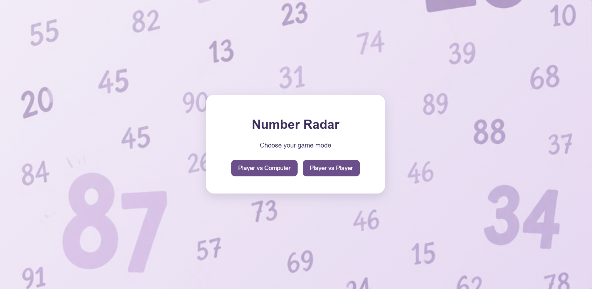
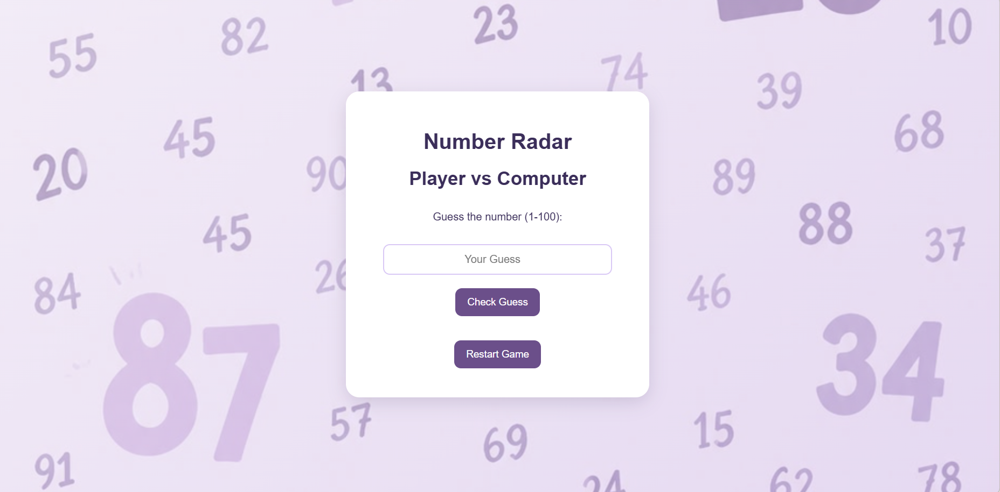
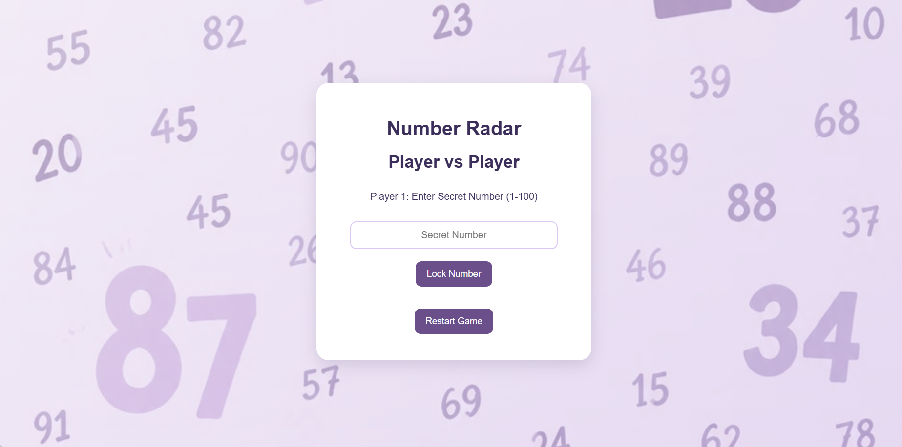
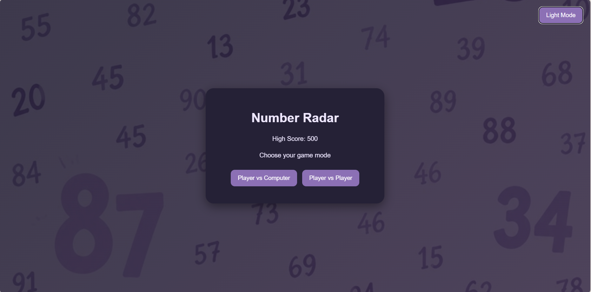

# Game name 
Number Radar 

## Descreption 
A simple yet engaging game with two modes. In Player vs Computer mode, the player tries to guess a randomly generated secret number. In Player vs Player mode, Player 1 creates a custom secret number, and Player 2 tries to guess it. With each guess, the game gives instant feedback ('Too High' or 'Too Low') to guide the player toward the correct answer in the fewest attempts possible.

## Technologies used 
1. HTML 
2. CSS
3. JavaScript 

## User Stories 
1. As a User, I want to choose between Player Vs Computer (PvC) and Player vs Player (PvP) modes at the start, so that I can decide how I want to play

2. As a User in PvC mode , I want the system to randomly generate a secret number within the (1-100) range at the start of each game, so that every round offers a fresh and unpredictable challenge.

3. As User 1 in PvP mode, I want to secretly enter a custom number within the (1-100) range, so that User 2 has to guess my specific number instead of a computer-generated one.

4. As a User, I want to enter my numerical guess into the system, so that I can try to match the secret number.

5. As a User, I want the game to tell me whether my guess is too high or too low, so that I can adjust my next guess logically.

6. As a User, I want the game to congratulate me and display how many total tries it took when I guess the right number, so that I know I won and can see my performance score.

7. As a User, I want to experience a maximum limit on my number of attempts, so that the game has higher stakes and tension.

## Links
[GitHub](https://github.com/KawthaarAman/Number-Radar-.git)

## Screenshots

## Credits